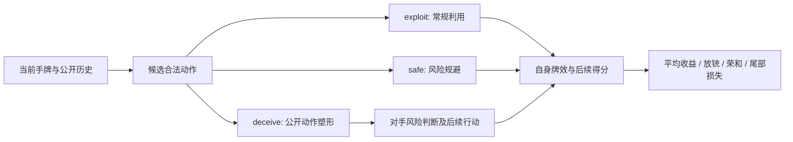
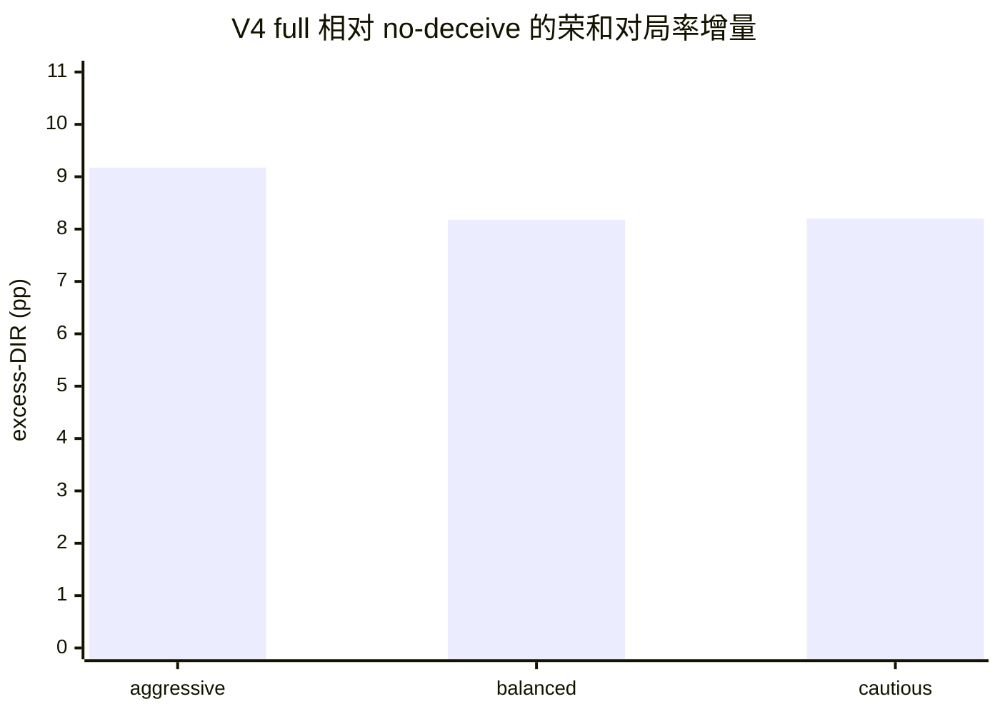

# MASK 论文内容初稿：P4 主实验与 V4 神经对手补充实验

> 写作口径：P4 是规则课程主实验；V4 是独立风险感知神经对手补充实验。新增 M1 的 `L1(z+B_phi)` 独立配对评测见 `L1_Z_BPHI_P4_20260914/PROTOCOL.md`，未审计完成前不得用旧 L1(z) 数值填充。E2 对比和 E3 消融拟重新评测，本稿暂只保留其设计及待填结果模板；其他已填数据均注明原 P4/V4 来源，不应与未来重跑结果混合。投稿前须核对原始 JSON、图题及目标会议模板。

## 1. 研究背景

麻将是多人、不完全信息、具有随机发牌和高风险尾部损失的序贯决策环境。玩家既要依据自己的手牌追求胡牌，也要通过公开弃牌、副露、缺门和局面进度推断对手的状态。与此同时，自己的动作也会成为其他玩家用于判断威胁的信息。因而，选择动作不仅改变自己的牌型，还可能改变对手后续的进攻、防守和弃牌选择。

本研究聚焦四川血战到底仿真环境中的一个可检验问题：在不泄露隐藏手牌、不改变合法动作集合的前提下，能否通过选择性公开动作影响对手的风险判断，并在控制自身放铳及尾部损失的同时增加荣和收益？这里的“欺骗”是策略性选择合法动作及其公开信号，不等于任意伪造信息，也不等于操纵真实人类心理。

## 2. 动机与难点（图 1）

被动策略只考虑“这张牌对我现在有利吗”；动作层塑形还要考虑“对手看到这张牌后，会怎样调整后续动作”。若一味追求威胁信号或错误防守次数，可能破坏牌效、增加放铳并拖累最差局面。另一个难点是可测量性：对手的内部信念无法直接从真实对局获得；在可执行规则对手上，可用公开信息威胁响应作机制观察，并用对局结果而非诊断计数检验实际收益。



图 1：同一动作同时作用于自身牌型和对手可见历史；困难在于估计其长期净收益，而不是最大化威胁变化量。

## 3. 相关工作（概念对比，非跨数据集数值比较）

| 方向与代表研究 | 主要问题或工具 | 与本工作的关系及边界 |
|---|---|---|
| [Suphx](https://arxiv.org/abs/2003.13590) | 麻将深度强化学习、奖励预测与运行时适配 | 相关的麻将决策基线；本文实验对象是另一规则/环境配置，不能直接比较分数或实力。 |
| [DeepStack](https://arxiv.org/abs/1701.01724)、[ReBeL](https://arxiv.org/abs/2007.13544) | 不完全信息博弈中的价值估计、搜索和自博弈 | 说明推断与价值估计的重要性；本文未实现其求解过程，也无均衡收敛保证。 |
| [LOLA](https://arxiv.org/abs/1709.04326) | 在对手会学习的情况下塑形其学习动态 | 本文塑形的是冻结对手对公开动作的即时响应，不是对手在线学习的梯度更新。 |
| [Bayesian Persuasion](https://www.aeaweb.org/articles?id=10.1257%2Faer.101.6.2590) | 发送者通过可观察信号影响接收者判断 | 提供信息塑形的概念参照；本文不证明最优信号设计或满足其理论模型假设。 |
| [CVaR 方法](https://sites.math.washington.edu/~rtr/papers/rtr187-CVaR2.pdf) | 关注损失分布尾部 | 本文使用经验最差 10% 得分均值与离线风险惩罚，不提供理论最坏情形界。 |

这里的创新定位是“可执行对手响应 + 合法动作层塑形 + 离线风险敏感门控 + 对手与指标口径审计”，而不是声称首次在不完全信息博弈中引入信念、欺骗或风险控制。

## 4. 主要贡献

1. 构造公开信息 belief 输入和三模式动作候选（exploit/safe/deceive），通过离线反事实 rollout 学习选择性门控，而非固定频率使用诱导动作。
2. 用可执行、行为筛选并冻结的参数化对手课程进行训练分布构造与独立 holdout 评测；公开信号响应由实际行为探针验证，不以对手名称代替行为证据。
3. 给出区分“荣和对局率”“严格错误弃和率（FFR）”“条件防守切换率”的可审计评估；使用对局级 CRN 和 outer-seed 配对统计。
4. 设计平均分、DR、荣和及经验 CVaR 的配对系统比较，并以无 deceive、无课程、无 belief 和恒 deceive 等消融检验各模块的贡献；另以风险感知神经对手检验有限的外部有效性。E2/E3 的最终数值和结论以重跑结果为准。

## 5. 问题建模与符号

设 P0 为研究策略，P1--P3 为对手。时刻 t 的公开历史是 H_t，P0 的私有手牌是 x_{0,t}；合法动作集合为 A_t。对手 j 只根据其合法观测估计 P0 的威胁 q_{j,t}，而不是读取 P0 的真实手牌。

| 符号 | 含义 |
|---|---|
| H_t, x_{0,t} | 时刻 t 的公开历史、P0 私有手牌 |
| A_t, m_t | 合法动作集；所选模式 m 属于 {exploit, safe, deceive} |
| a_t^m | 模式 m 对应的合法候选动作（可能不可用或与其他模式重合） |
| z_t, B_phi(H_t) | 公开状态摘要；冻结的公开信息风险预测输入 |
| q_{j,t} | 对手 j 从自身合法观测形成的 P0 威胁估计；规则对手可审计，V4 为神经风险头 |
| R_g, DR, DIR | P0 单局净分、放铳对局率、荣和对局率 |
| CVaR_10%(R) | 单局得分最低 10% 的经验平均值，越大越好 |
| V_m(s_t) | 对候选模式 m 的反事实继续对局风险敏感价值 |

离线采集时，在同一状态 s_t 对可用的各模式分别使用配对随机数做后续 rollout，计算：

`U_m(s_t) = mean(R_m) - 0.1 * max(0, -CVaR_25%(R_m)) - 256 * P(hua_zhu | s_t, m)`。

这是**训练标签的效用函数**，其尾部分位为 25%；正式实验报告的 CVaR 指标使用最差 **10%** 对局，两者不能混写。训练 GateValue 拟合各模式效用并据此选择动作；这里不是 CFR 的逐步遗憾最小化，也没有在线通过对手反馈更新参数。

## 6. 整体框架（图 2）


图 2：三模块及训练/评测边界。课程生成的是可执行对手配置，6 个 train 对手用于离线反事实价值数据采集并训练 GateValue；Qwen 基础策略保持冻结，3 个 holdout 对手不用于门控训练。B_phi 是 P0 的风险输入；对手对 P0 的威胁判断属于其自身响应，不能与 B_phi 等同。图中公开动作影响对手后续行为是一条待评测路径，不表示每次 deceive 都能导致荣和。

## 7. 核心方法与算法


图 M1：方法由公开信息表征、三模式合法候选与门控、离线课程价值学习组成。训练期在同一状态使用配对随机数比较候选模式；部署期只运行冻结的网络前向预测，不对对手做在线参数更新，也不对 Qwen 基础策略做课程 SFT。

### 7.1 公开信息局面与风险表征

P0 结合自身手牌及公开历史构造对手行为摘要 `z_j`，并用冻结的公开信息模型 `B_phi` 估计对手听牌风险。`B_phi` 使用 raw public MC 与公开弃牌、副露、缺门和牌局阶段等特征；校准映射仅从 E1 的训练部分拟合，后续冻结。两组信息与当前合法候选动作特征一起输入 GateValue。`B_phi` 是 **P0 对对手**的风险输入；对手对 P0 的威胁判断是另一个量，不能相互替代。主实验消融仅支持 `B_phi` 在 DR 上的安全侧价值，而不支持其单独驱动得分或 DIR。

### 7.2 合法动作提案与选择性门控

基础 Qwen 策略给出常规 exploit 动作；safe 优先寻找兼顾当前进展的公开安全弃牌；P4 的 deceive 使用 `threat` 风格，在允许的牌效约束内寻找与常规动作不同、可提高公开威胁信号的弃牌。deceive 并非每回合都有合法且与其他模式不同的候选。候选生成后，GateValue 对可用模式的状态和动作特征输出三路价值，屏蔽不可用模式，再选择最高预测价值的模式。若非 exploit 的获选模式与次高模式的预测值差未达到冻结门槛（默认 0.05），则回退 exploit。这里的门槛是**预测值差规则**，不是经过证明的逐步安全保证。

### 7.3 对手课程驱动的离线价值学习

LLM 提出有界 JSON 对手参数，由可信 `ResponsiveDefender` 执行；合法性、强度和配对公开动作探针筛选后冻结 6 个 train 和 3 个 holdout 对手。用 6 个 train 对手模拟 732 局采集 900 个可比较状态，其中 240 个状态有 deceive 候选。对每个可用模式，在同一状态下使用 8 组配对随机数继续对局，形成候选价值标签：

`U_m = mean(R_m) - 0.1 * max(0, -CVaR_25%(R_m)) - 256 * P(hua_zhu | m)`。

过滤 125 个候选价值跨度过小的状态后，保留 775 行，按整局 seed 划分 620 行训练和 155 行验证。GateValue 是隐藏维度为 128/64 的三输出 MLP；训练综合价值回归、最佳模式排序、期望价值与熵正则。训练标签的 CVaR-25% **不同于**正式结果报告的 CVaR-10%。P4 仅修复终局处理及严格 FFR 测量，沿用冻结的模型权重。

```text
算法 1：离线采集与训练 GateValue
输入：6 个 train 对手、冻结的 Qwen 和 B_phi、每状态 8 组 CRN
数据集 D <- 空集
在训练对手上模拟，并按冻结规则抽取 P0 的决策状态 s：
    生成 exploit、safe、deceive 的合法候选动作
    屏蔽不可用或与其他模式相同的动作
    若可比较模式少于 2 个：继续下一状态
    对每个可用模式 m：
        从同一状态执行 a_m，用同一组 CRN 继续对局
        U_m <- 平均净收益 - 0.1 * 负的 CVaR-25% 惩罚 - 256 * 花猪率
    将 (状态特征、候选动作特征、可用模式掩码、U_m) 加入 D
过滤低价值跨度状态；按 game seed 分组划分训练/验证集
拟合三输出 GateValue 网络；冻结权重与特征归一化参数

算法 2：冻结策略的单步执行
输入：P0 合法观测、冻结的 Qwen、B_phi 和 GateValue
生成常规 exploit、公开安全 safe 和威胁风格 deceive 候选
如果常规动作是胡牌：依冻结规则直接返回该动作
计算 z、B_phi、候选动作特征与可用模式掩码
如果只有一个可用模式：返回它的合法动作
对可用模式进行一次 GateValue 前向打分；取最高分模式 m
如果 m != exploit 且最高分与次高分的差低于冻结门槛：m <- exploit
返回 a_m；不执行部署期反事实 rollout 或在线梯度更新
```

课程消融 `-course` 保持结构与训练方法，但改从手工 mixed（aggressive/conservative/random）对手采集价值数据；评价仍在同一 holdout 上。`-risk` 则复用 full 权重，只改变部署时的选择门控。不能把它们都描述为“从零重新训练同一个模块”。

## 8. 实验设置

### 8.1 软件、硬件与复现条件

| 项目 | 可核实的设置 | 报告边界 |
|---|---|---|
| 基础策略与课程生成 | 冻结的 `models/Qwen-Mahjong-V3-Merged` 用于 P0；`Qwen2.5-1.5B-Instruct` 生成有界 JSON 对手参数，由可信 `ResponsiveDefender` 执行 | 课程模型不是对局中的在线决策者；P4 不重新训练基础 Qwen |
| 学习与推理软件 | Python/PyTorch 训练 GateValue；joblib 加载冻结的公开 belief 模型；本地实验入口使用 `py10/bin/python3` | 当前环境快照（2026-09-12）：Python `3.10.19`、PyTorch `2.10.0+cu128`（PyTorch CUDA `12.8`）；系统 `nvcc` 为 `12.0`。P4 历史运行时版本仍待日志核实 |
| 计算与并发 | 当前机器两张 `NVIDIA GeForce RTX 4090 D`，每张显存 `49140 MiB`；当前驱动 `570.211.01`，`nvidia-smi` 显示驱动支持 CUDA `12.8`。P4 正式入口指定单 GPU（`--gpu 0`）、8 个并行 workers；V4 扩展评测也冻结单 GPU、8 workers | 以上硬件/驱动为 2026-09-12 的机器快照，不能证明 P4 历史实际使用的型号、驱动或工具链；CPU/内存及历史版本投稿前从原始运行日志补齐，不把双卡配置写成双卡同时参与 P4 |
| 冻结工件 | 课程 fingerprint `476a3ae56da82a59`；公开 belief SHA-256 `d5bd71f50633eb5dadae49e396ff9bbcb4c6899538891409ab7d7e80c01364c3`；full GateValue SHA-256 `af105336a034e2865e54a0a56fcc22d75f469ae755cec1f40f65cd8e1aa2a3cb` | 所有正式单元校验配置、模型及逐局 seeds；未通过审计的运行不得纳入论文 |

### 8.2 参数、对手和数据划分

| 环节 | 设置 | 对论文结论的作用 |
|---|---|---|
| 课程构建 | 26 个生成阶段候选各评测 100 局，另做 6 组配对公开信号探针；行为筛选后冻结 6 train / 3 holdout | 同一对手实现的不同参数实例；holdout 不进入 GateValue 采集 |
| 公开 belief | 预训练数据 71,964 行、4,397 game seeds；公开 MC 样本数 60、`beta=2.0`、危险阈值 0 | E1 独立 seed family 验证；冻结模型用于后续系统，不在评测 holdout 上重新拟合 |
| E1/H1 | 独立 mixed 规则对手环境（不是 6 个课程 train）；600 局、9,468 样本；前 300 局用于先验/校准，后 300 局独立评测；balanced eval 为 2,430 样本、297 个 game-seed clusters | 与 P4 的课程 holdout 和 320,000 局正式重跑分开统计 |
| GateValue 采集 | 从 6 train 对手采 900 个状态，其中 240 个有可用 deceive 候选；各模式使用 8 组 CRN continuation rollouts；过滤 125 个低价值跨度状态 | 剩余 775 条可用样本，按整局分组划分 620 条训练、155 条验证；无部署期在线更新 |
| GateValue 拟合 | MLP 隐层 `[128,64]`；最多 50 epochs，batch 64，学习率 `5e-4`，weight decay `1e-4`；默认选择 margin `0.05` | 反事实标签中使用最差 25% 收益（CVaR-25%）惩罚系数 `0.1` 与花猪惩罚系数 `256`；**评测**另报 CVaR-10%，不能混用 |
| P4 对局设置 | `auto_hu=off`；外层 seeds `2026082001` 至 `2026082020`（20 个）；每设置每 seed 1,000 局；逐局 seed=`outer_seed*1000000+game_index` | 同分布设置共享逐局 seeds，按外层 seed 做 CRN 配对比较；smoke 1,600 局不进入正式统计 |
| E2/E3 | 8 个系统各 20,000 局，共 160,000 局；P1-P3 为冻结的 3 个课程 holdout 对手 | 比较系统阶梯与严格消融 |
| E4 | full 在 6 个 train 对手上新跑 20,000 局；在 3 个 holdout 上复用 E2/E3 的 full 20,000 局 | 只检验冻结的未见参数，不代表更难或开放世界对手 |
| E5 | holdout 新跑 tight/loose 共 40,000 局，其余基准复用 E2/E3；`anti_deception` 压力对手五设置新跑 100,000 局 | 压力对手是冻结规则策略，不是在线学习者或理论最优响应 |
| E6 | 不新跑对局；复用 P4 full 的 20,000 局、271,517 次决策及 814,551 条对手级 belief 样本 | 分析校准、动作响应、案例与总决策延迟 |
| V4 补充 | 3 个独立规则教师训练的风险感知神经 profile（aggressive/balanced/cautious）；冻结进展护栏及 checkpoint；20 个**新**外层 seeds `2026090701`--`2026090720`；每 profile/设置/seed 200 局 | 3 profiles x 2 P0 设置 x 20 seeds x 200 = 24,000 局；与 P4 不合并检验 |

原 P4 共新增模拟 **320,000 局**（E2/E3 160,000 + E4 20,000 + E5 140,000）；这是历史已完成规模，**不是拟重跑的新增预算或结果**。E6 复用已有轨迹，E1 和 V4 均不计入该总数。重跑前须另行冻结规模及协议；完整性审计至少包括每单元 game seeds 唯一、跨系统配对、工件哈希一致、`max_steps_or_unsettled=0`，以及严格 FFR 分子/分母和去重事件。

### 8.3 对比算法与控制变量

| 实验 | 对照与干预 | 保持一致的条件 |
|---|---|---|
| E1 | B0 frequency prior、B1 public-z、B2 public `B_phi`，并分别评估 isotonic 映射 | 同一独立评测集；balanced 为预先指定主判据，natural 仅作分布参考 |
| E2 | L0 Qwen-base；L1 reactive-z；L2 no-deceive（safe/exploit）；MASK-full（safe/exploit/deceive） | 原 P4 使用同一 holdout 和逐局 CRN seeds，full vs no-deceive 为 H2 主比较；重跑需重新冻结并审计条件 |
| M1 补充 | 新 `L1(z+B_phi)` 对比原 P4 `L1(z)` | 只更换 L1 风险门控的 belief 输入并记录实际动作变化；同 20 outer seeds、每 seed 1,000 局和同 holdout。不能据此替代 GateValue 的 `-B_phi` 消融 |
| E3 | full 对比 `-z`、`-B_phi`、`-deceive`、`-risk`/constant-deceive、`-course` | 原 P4 中 `-z/-B_phi` 训练和部署均移除特征，`-deceive/-course` 分别重训 GateValue，`-risk` 仅改部署；重跑需保持各消融语义可比 |
| E4 | 同一 full 在 6 train 与 3 unseen holdout 参数对手上评测；holdout 上同时对比 L1、`-course` | 全程冻结 full 权重；改变的是对手参数分布而非重新适应 |
| E5 | no-deceive、tight（deceive margin `0.15`）、default（`0.05`）、loose（`0.00`）、constant-deceive（绕过门控）；safe margin 均 `0.05` | 相同 full checkpoint 用于三种 margin 和 constant；no-deceive 使用独立重训 checkpoint；在普通 holdout 与反欺骗压力对手上分别配对 |
| E6 | raw public MC、public-action model、冻结 isotonic；比较 deceive/exploit/safe 的动作响应与延迟 | 复用 full trace；不在 holdout 上重新校准；响应分析属描述性机制证据 |
| V4 补充 | 同 profile 下 P4 full vs no-deceive，仅用神经网络自身 `predicted` 风险头；三种进攻风格分开报告 | 冻结 P0 策略、对手 checkpoint/护栏；每 profile 内相同 game seeds；不与 P4 规则对手混作同一总体 |

外部基线 **Mix-PPO-adapted**：基于 Wang et al. 的 ResNet101 架构、公开信息编码和混合 PPO 训练目标的四川麻将适配版。由于已获取作者稿式(3)(4)的数学形式与文字描述存在不一致，且本次未找到公开代码，按 PPO 标准范式（Schulman et al., 2017）解释 KL 惩罚项和 clip-advantage 目标。该基线独立随机初始化，不使用 Qwen 或 MASK 三模块；具体偏离见附录 X。已完成10轮、1080局的短程训练预检，无正式holdout对比结果，不能据此判断算法优劣。

### 8.4 评估指标与统计方法

| 指标 | 计算与方向 | 使用范围及解释限制 |
|---|---|---|
| 平均净分 / 胡牌率 | P0 每局净分的均值 ↑ / P0 胡牌局数除以总局数 ↑ | 报告系统收益；均值不能单独替代尾部分析 |
| 荣和对局率与 excess-DIR | `ron_game_rate = P0 荣和局数/总局数` ↑；`excess-DIR = full - no-deceive` 在相同分布下的荣和对局率差，单位 pp ↑ | 是**按局**统计的配对系统差，不能解释为每张弃牌的点炮概率或单次欺骗的因果归因 |
| DR / CVaR-10% | `DR = P0 放铳局数/总局数` ↓；CVaR-10% 为最差 10% 对局净分均值 ↑ | CVaR 仅为冻结对手分布上的经验尾部指标，非最坏情形安全保证 |
| 严格 oracle FFR | 每 `(game_seed, opponent_pid)` 仅首个合格机会计一次：对手 oracle 向听 `<=1`、P0 oracle 向听 `>0` 且两动作均可比较；威胁达到对手阈值、防守动作不同于 push，并增加向听或同向听减少有效进张，才计入分子；分母为首个合格机会数 | P4 规则对手专用；同时报告分子/分母和对手级分解，不以约 50% 的“条件防守切换率”冒充严格 FFR |
| 条件防守切换率 / V4 严格行为 FFR | 前者是重复回合级的防守与 push 动作差异，仅诊断；后者在 V4 中按进展损失与首机会计算，但无规则对手的显式威胁阈值 | V4 是行为代理指标，不能和 P4 oracle FFR 的绝对值直接比较 |
| Belief 质量与机制 | AUC ↑（排序），Brier/ECE ↓（概率误差），DeltaBelief 为 P0 动作前后冻结规则对手威胁响应的配对差 | E1 与 E6 分布不同；DeltaBelief 不是真实人类心理观测，也不单独证明收益因果 |
| 决策耗时 | P0 总决策时延 p50/p95/p99 ↓ | E6 报告端到端延迟；没有可靠分模块时延，不声称 `<100ms` 实时部署 |

P4 E2--E5 的差异按 **20 个外层 seed** 在同一分布内配对，以双侧检验和 95% CI 报告；单局和单步不是独立推断单位。E3 多消融的名义 p 值未统一作多重比较校正，应结合效应量及方向解释。V4 按 profile 对 20 个**不同于 P4**的外层 seeds 配对，同时报告配对 t 检验、Wilcoxon 与 95% CI，并对三个 profile 的相关比较报告 Holm 校正；严格行为 FFR 和 CVaR 只作辅助指标。所有 V4 结论限于冻结的混合神经对手，不外推为人类或完全独立的端到端策略。

## 9. 实验结果与分析（E2/E3 待重跑）

### 9.1 E2：对比算法（待填）

固定同一评测对手、基础模型、逐局 seeds 与计分方式，比较从常规策略到选择性动作门控的四级系统。**以下仅为表格结构，`待重跑` 不表示旧 P4 数值为零。** 旧 P4 的历史表格可在 `FORMAL_RESULTS_SUMMARY_20260822.md` 查阅；在确认新运行协议及审计通过前，不将其填入本稿定稿表。

| 系统 | 核心区别 | 平均分↑ | 胡牌率↑ | 荣和对局率↑ | DR↓ | CVaR-10%↑ | 严格 FFR（辅助） |
|---|---|---:|---:|---:|---:|---:|---:|
| L0 Qwen-base | 冻结基础策略 | 待重跑 | 待重跑 | 待重跑 | 待重跑 | 待重跑 | 待重跑 |
| L1 reactive-z | 基础策略 + `z` 规则防守；原 P4 已有结果，不含 `B_phi` | 待定稿 | 待定稿 | 待定稿 | 待定稿 | 待定稿 | 待定稿 |
| L1(z+B_phi)，M1 补充 | 在相同 L1 规则防守中加入冻结公开 `B_phi` 的威胁响应输入；独立配对评测进行中 | 待新评测 | 待新评测 | 待新评测 | 待新评测 | 待新评测 | 待新评测 |
| L1(z+B_phi)，M1 新增 | L1 的规则防守加入冻结公开 belief | 待审计 | 待审计 | 待审计 | 待审计 | 待审计 | 待审计 |
| L2 no-deceive | GateValue 仅从 safe/exploit 选取 | 待重跑 | 待重跑 | 待重跑 | 待重跑 | 待重跑 | 待重跑 |
| MASK-full | GateValue 从 safe/exploit/deceive 选择 | 待重跑 | 待重跑 | 待重跑 | 待重跑 | 待重跑 | 待重跑 |

| 配对比较（full - baseline） | 平均分差（95% CI；p） | excess-DIR（95% CI；p） | DR 差（95% CI；p） | CVaR-10% 差（95% CI；p） | 严格 FFR 差（辅助） |
|---|---|---|---|---|---|
| full - L0 | 待重跑 | 待重跑 | 待重跑 | 待重跑 | 待重跑 |
| full - L1 | 待重跑 | 待重跑 | 待重跑 | 待重跑 | 待重跑 |
| **full - no-deceive（主比较）** | **待重跑** | **待重跑** | **待重跑** | **待重跑** | **待重跑** |

图 3 待重跑后分别展示平均分、荣和对局率、DR 与 CVaR-10% 的配对差及 95% CI；不将分值和百分比合绘为一个纵轴，也不以严格 FFR 的绝对值代替主收益证据。

M1 补充协议见 `L1_Z_BPHI_P4_20260914/PROTOCOL.md`：新 L1 与旧 P4 L1 使用相同的 20 个 outer seeds、每 seed 1,000 局和相同的 holdout 对手，预检 5 局不入正式统计。这里的 `B_phi` 是 P0 的公开感知威胁估计，不能写成对手隐藏手牌风险；只有正式审计及配对比较完成后才能填写 M1 的增量。

### 9.2 E3：模块消融（待填）

| 变体 | 干预内容 | 平均分↑ | 荣和对局率↑ | DR↓ | CVaR-10%↑ | 严格 FFR（辅助） |
|---|---|---:|---:|---:|---:|---:|
| full | 全部模块 | 待重跑 | 待重跑 | 待重跑 | 待重跑 | 待重跑 |
| `-z` | 移除状态摘要特征并重训 GateValue | 待重跑 | 待重跑 | 待重跑 | 待重跑 | 待重跑 |
| `-B_phi` | 移除公开 belief 特征并重训 GateValue | 待重跑 | 待重跑 | 待重跑 | 待重跑 | 待重跑 |
| `-deceive` | 关闭 deceive 模式并重训 GateValue | 待重跑 | 待重跑 | 待重跑 | 待重跑 | 待重跑 |
| `-risk` | 冻结 full 权重；部署时在可用时强制 deceive | 待重跑 | 待重跑 | 待重跑 | 待重跑 | 待重跑 |
| `-course` | 改用手工课程采集价值数据并重训 GateValue | 待重跑 | 待重跑 | 待重跑 | 待重跑 | 待重跑 |

| 配对消融（full - 变体） | 平均分差（95% CI；p） | excess-DIR（95% CI；p） | DR 差（95% CI；p） | CVaR-10% 差（95% CI；p） | 严格 FFR 差（辅助） |
|---|---|---|---|---|---|
| full - `-z` | 待重跑 | 待重跑 | 待重跑 | 待重跑 | 待重跑 |
| full - `-B_phi` | 待重跑 | 待重跑 | 待重跑 | 待重跑 | 待重跑 |
| full - `-deceive` | 待重跑 | 待重跑 | 待重跑 | 待重跑 | 待重跑 |
| full - `-risk` | 待重跑 | 待重跑 | 待重跑 | 待重跑 | 待重跑 |
| full - `-course` | 待重跑 | 待重跑 | 待重跑 | 待重跑 | 待重跑 |

图 4 待填为各模块的配对效应与 95% CI；对方向冲突的指标分别解释。E3 多项比较应说明显著性处理，不能根据某一辅助指标反推模块整体收益。上述设计沿用原 P4 的消融定义；若重跑改变 checkpoint、训练数据或评测分布，应单独记载，不能与旧 P4 的 E4--E6 结果直接拼成一套新实验。

**原 P4 冻结结果（E1、E4--E6；待确认是否随 E2/E3 同步重跑）。** E1 balanced B_phi AUC `0.7897`，Brier `0.1831`，相比 B0/B1 分别降低 `42.87%/30.69%`（297 个 game clusters 配对 p=`5.45e-18/5.45e-14`）。原 E4 full 在 train/holdout 平均分 `22.460/24.893`、CVaR `-72.440/-58.390`，保留率 `110.83%`；但 holdout 显著更容易，故仅限定支持未见参数迁移。原 E5 在 holdout 上 default 胜于 no-deceive 和 constant-deceive；在 anti-deception 冻结压力对手上，loose 相对 no-deceive 的 CVaR 改善 `+13.635`（p=`0.0223`）；不推导理论最坏情形。原 E6 deceive 后对手威胁响应均值 `+0.02103`、正向率 `62.73%`，只是描述性机理证据；跨分布校准失败（isotonic Brier/ECE `0.1193/0.2561`，raw MC `0.1131/0.2406`），p95 延迟 `446.4ms` 未达到 `<100ms` 目标。若新 E2/E3 使用不同策略、规则或轨迹，这些原 P4 结果不得充当新实验的 E4--E6。

**图 5：V4 独立神经对手补充结果（画同 profile 的配对效果和 CI，不与 P4 分数直接混合）。**



图 5 此处仅为效果示意；提交论文时需依据逐 seed 结果绘制 95% CI 和显著性标注，不应把上面的简单柱图当成已经包含统计不确定性的正式图。

| 风格 | full - no-deceive 平均分 | excess-DIR | DR 差 | CVaR 差 | 判读 |
|---|---:|---:|---:|---:|---|
| aggressive | +3.482 (Holm p=`0.00428`) | +9.175pp | -4.525pp | +10.650 | 得分、DIR、DR 有证据；尾部改善 |
| balanced | +1.973 (Holm p=`0.255`) | +8.175pp | -4.100pp | -0.650 | 得分、尾部单项不显著 |
| cautious | +3.705 (Holm p=`0.00660`) | +8.200pp | -3.950pp | +3.925 | 得分、DIR、DR 有证据 |

V4 三风格的 DIR 与 DR 均显著改善；得分三个方向为正、其中两个风格经 Holm 校正显著，满足预冻结跨风格规则，但**balanced 单独得分不显著**。风险头能预测并影响动作，但 V4 使用独立规则动作教师及运行时进展护栏；不能表述为纯端到端训练、人的心理真实量或人类对局实验。本文没有实物设备/真实人类对局实验，不能补写此类结果。

## 10. 总结与启发

**总结。** 本研究把麻将中的合法公开动作同时视为牌效决策和对手可见信号，构建公开信息表征、三模式动作候选与离线学习的风险门控，并使用行为筛选的冻结对手课程评估其作用。原 P4 规则对手实验显示：相对于无 deceive 门控，选择性塑形在该冻结分布上提高平均分与荣和对局率，降低 P0 放铳并改善经验 CVaR；恒定选择 deceive 则无法取得同样的系统收益。V4 补充实验在三种独立规则教师训练的风险感知神经对手上观察到荣和率上升、DR 降低，但不能据此推断对任意神经或人类对手均有效。由于 E2/E3 拟重跑，以上 P4 结果只是已有证据，不预先作为新批次的结论。

**启发。** 第一，动作塑形应以净收益及风险权衡为目标，而非最大化欺骗频率、威胁响应幅度或错误防守次数：原 P4 普通 holdout 上严格 FFR 并未显著提高，系统收益主要与荣和对局率差及风险改善共同出现。第二，公开 belief 的预测能力不等于决策贡献；原 `-B_phi` 消融仅支持 DR 安全侧作用，不能称其为主要得分来源。第三，可执行课程便于控制对手响应、进行公平配对和消融归因，但冻结规则对手及带护栏的混合神经对手都不能代表开放世界；因此应把内部机制解释与跨对手有效性分开报告。

**局限与后续。** 原 P4 的 holdout 参数对手整体更容易，E6 显示跨分布概率校准退化、推理 p95 未达原实时目标；V4 也不是人类牌谱或纯端到端自博弈对手。后续应在独立来源且强度可核查的对手、真实牌谱或人类对局上测试，并改进跨分布校准与推理耗时。新 E2/E3 完成后，先按冻结口径重做配对统计，再判断 E4--E6 是否需要同步重算；不拼接不兼容批次，也不主张在线反适应、Nash 安全或普适最坏情形保证。

### 数据来源与核对入口

- `FORMAL_RESULTS_SUMMARY_20260822.md`：E1--E6 的 P4 汇总与显著性；具体数值以各原始 JSON 为准。
- `STRICT_FFR_RERUN_PROTOCOL_20260823.md`：P4 冻结定义、seeds、checkpoint 与运行规模。
- `Formal_E2_E3_P3R_20260817/data_course/gate_mode_value_collection_summary.json`、`model_full/gate_value_training_summary.json`：冻结 GateValue 数据采集与训练细节。
- `Neural_Opponent_V4_IndependentRisk_20260902/EXPANDED_EVAL_REPORT_20260903.md`：独立神经对手 20-seed 扩展。

## 附录 X：Mix-PPO-adapted 的解释与迁移偏离

参考原文：[Wang et al., DOI:10.1109/TG.2024.3507107](https://doi.org/10.1109/TG.2024.3507107)；标准 PPO：[Schulman et al., 2017](https://arxiv.org/abs/1707.06347)。本基线不称原系统完整复现。

策略目标为 `mean(min(r*A, clip(r,0.8,1.2)*A)) - delta*mean(KL(old||new)) + 0.01*mean(H)`，并最小化价值均方误差。每轮更新结束后按完整 rollout 的 KL 调整 delta：小于 target/1.5 则减半，大于 target*1.5 则加倍；初始 delta=.005，target=.01。熵系数固定.01。clip与KL同时生效，是本文明确的适配选择。

迁移保留去池化的 ResNet101 共享主干及公开牌桌编码思路，采用3x9四川麻将布局和31类动作（27弃牌及胡/杠/碰/过），不用LLM初始化。原文前瞻搜索、先知信息退火、目标升级自博弈未纳入当前版本；训练对手采用冻结train课程，奖励采用完整结算的净分变化/100。BatchNorm running statistics固定以保证采样和更新概率的一致性，仿射参数仍训练。这些区别意味着后续结果仅代表该适配版。

详细配置、验证和源码哈希入口：`Mix_PPO_Sichuan_20260916/ADAPTATION_PROTOCOL.md` 及每次训练目录中的 `config.json`。正式结果填表前另行完成预算、模型冻结及CRN审计。
